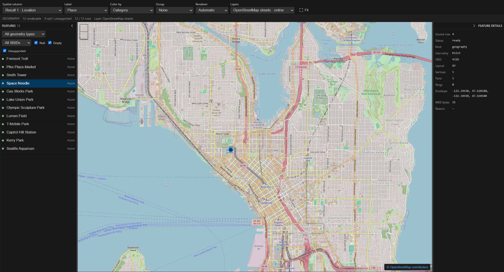
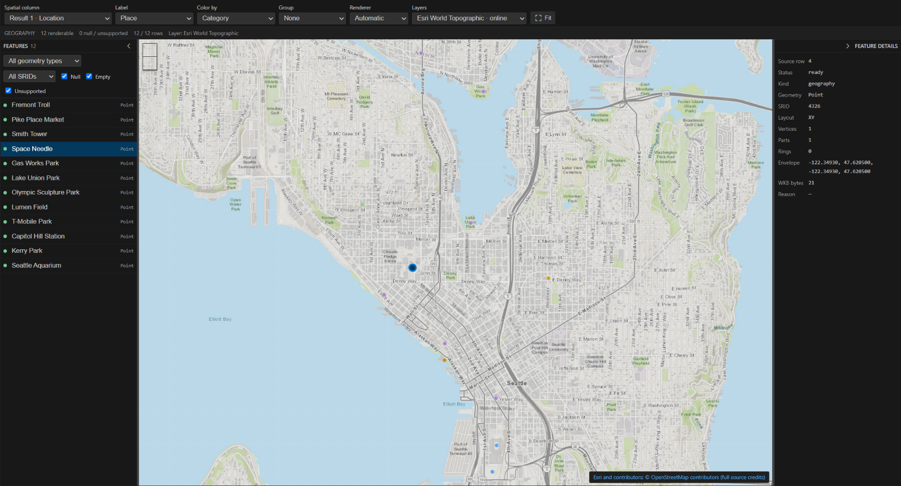
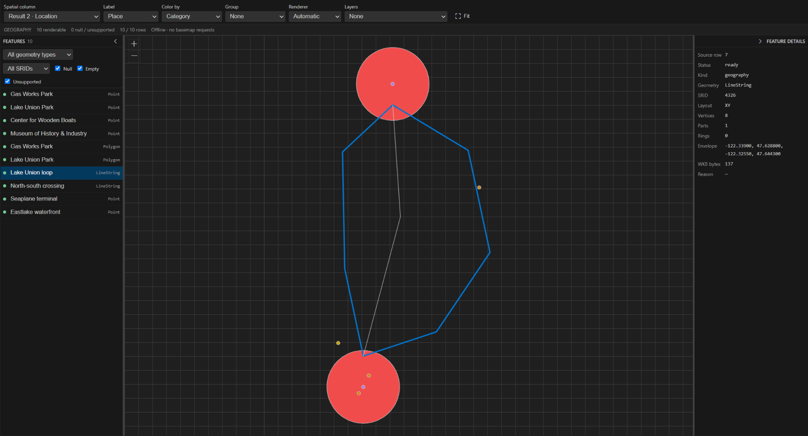
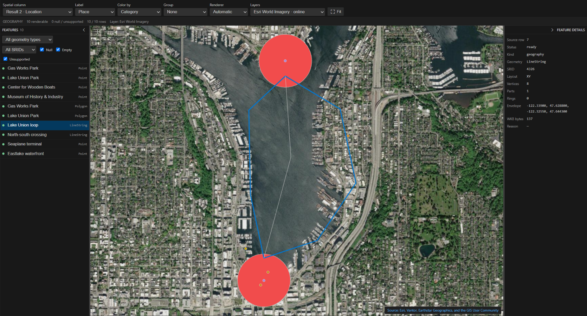

# Spatial results (Private Preview)

Query Studio can display SQL Server `geometry` and `geography` results in a map alongside the grid. The same pane works in pinned original results. This is independent of Chat to Data and does not require Copilot.

## Enable and try

```json
{
    "mssql.enableExperimentalFeatures": true,
    "mssql.sqlDataPlane.enabled": true,
    "mssql.queryStudio.enabled": true,
    "mssql.queryStudio.spatial.enabled": true
}
```

Reload the extension after enabling Query Studio. In a connected `.mssql` document or a new Query Studio query, execute:

```sql
SELECT N'Seattle' AS city, geography::Point(47.6, -122.3, 4326) AS location
UNION ALL
SELECT N'London', geography::Point(51.5, -0.1, 4326);
```

Choose **Spatial** in the results pane. Select the spatial column, optional label/color columns, and a renderer. The feature list and details panel preserve source row identities. Pan, zoom, filter the displayed features, fit the view, or export the map as PNG. Pin the original results to inspect the same map after rerunning or closing the source query.

The flag defaults **off**. Enabling it applies typed spatial transport to subsequent queries when the backend advertises support. Rerun an existing query after enabling it. Ordinary SQL editor results are unaffected. Map code and the decoder worker load only when the spatial pane is used.

## Offline and optional online layers

The map and bundled world outline work offline. Online basemaps default off. Opening the map may offer to configure OpenStreetMap; accepting configures a layer and records the explicit network consent. Online requests are made by the extension host, restricted to trusted workspaces and approved HTTPS sources. Map tiles reveal the viewed area to that provider; query rows, SQL, and server credentials are not sent.

Advanced settings under `mssql.queryStudio.spatial.basemap` configure sources and bounded disk caching. For an authenticated provider, configure its `credentialRef`, then run **MS SQL: Spatial Map Layers: Set Layer Credential** to store its bearer token securely (an empty entry removes it). Credentials never enter webview URLs. Private-network sources require an additional warning and confirmation. **MS SQL: Spatial Map Layers: Clear Tile Cache** and **MS SQL: Spatial Map Layers: Clear Layer Consent** clear cached tiles or remembered permissions. Configuration or consent changes invalidate active sessions; cache budget changes apply without reloading.

## Seattle gallery

These captures show the spatial pane in the packaged extension, using the [Seattle sample query](../samples/query-studio-spatial-seattle.sql). It runs without AdventureWorks and uses only table variables; it does not create permanent database objects. Landmark coordinates are approximate, and the Lake Union routes and 250-meter park areas are illustrative.

To reproduce the views:

1. Merge the [example layer settings](../samples/query-studio-spatial-layers.json) into User settings and reload. They include the preview flags, OpenStreetMap streets, Esri World Topographic, and Esri World Imagery.
2. Execute the sample in a connected Query Studio document and choose **Spatial**. Set **Label** to **Place** and **Color by** to **Category**.
3. Use **Spatial column** to switch between the two result sets, then **Fit**. The first has 12 Seattle landmarks; the second combines Lake Union points, lines, and polygons.
4. Choose a background with **Layers** and accept the provider consent prompt for online layers. **None** draws just the query features without online tiles.

### Seattle landmarks with street detail

OpenStreetMap shows the streets around the landmarks; selecting a feature links the map, feature list, and geometry details.



### Seattle landmarks on a topographic map

The same query features with the Esri World Topographic background.



Topographic sources: Esri, HERE, Garmin, Intermap, increment P Corp., GEBCO, USGS, FAO, NPS, NRCAN, GeoBase, IGN, Kadaster NL, Ordnance Survey, Esri Japan, METI, Esri China (Hong Kong), © OpenStreetMap contributors, and the GIS User Community. The viewer's attribution link opens the provider's full source credits.

### Lake Union features without a basemap

Points, illustrative routes, and park areas render without an online background.



### Lake Union over satellite imagery

The same Lake Union features over Esri World Imagery. Provider attribution remains visible in the viewer.



## Scope and limits

Spatial transport, decoding, and rendering have row, byte, and geometry budgets. The pane reports partial, unavailable, null, empty, unsupported, and mixed-SRID results rather than silently treating them as valid points. Geometry coordinates are planar; geography uses the map projection where supported. The pane is a viewer, not a spatial editor or an implicit database reprojection operation.

Derived/filtered Chat to Data snapshots are not mapped in this extraction because their logical row ordinals differ from the original store. Pin the original result set instead. Vector analysis, query replay, Chat to Data, and schema designer changes are outside this PR.
